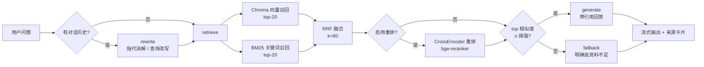

# 知识库问答助手（RAG + LangGraph）

把一堆技术文档变成一个**能回答、能给出处、找不到就说找不到**的问答助手。

> **实测**：12 篇文档 / 413 个块，recall@5 = **1.00**（10/10），faithfulness = **5.00**（自建 10 题评估集 + LLM-as-judge）。口径见 [评估](#评估)。
>
> **语料可替换**：默认抓 FastAPI 中文文档（公开、好取、含大量 API 名，正好压测关键词召回）。改 `data/sources.txt` 换成任意文档即可复用，不用改代码。
>
> **跑起来看**：`streamlit run app.py`，问「FastAPI 怎么定义路径参数？」就能看到流式回答和来源卡片。
> <!-- 录好 60 秒演示后，把 gif 放到 docs/demo.gif，并取消下一行注释 -->
> <!--  -->

- 向量检索用本地开源模型 `BAAI/bge-m3`，不依赖外部向量 API
- 向量 + BM25 混合召回，RRF 融合，可选 CrossEncoder 重排
- LangGraph 编排「查询改写 → 检索 → 条件生成/兜底」
- Streamlit 流式界面，回答带 `[n]` 引用与来源卡片
- 离线单测 + 10 题检索/忠实度评估脚本

---

## 架构



### LangGraph 状态

```python
class RAGState(TypedDict, total=False):
    question: str              # 原始问题
    chat_history: list[BaseMessage]
    standalone_question: str   # 改写后的独立问题
    documents: list[Document]  # 检索结果
    top_similarity: float      # 相关性信号
    answer: str
    used_fallback: bool
```

四个节点：`rewrite` → `retrieve` →（条件边）`generate` / `fallback`。
首轮没有历史时跳过 `rewrite`，节省一次 LLM 调用。

---

## 快速开始

### 1. 创建环境并安装依赖

```bat
python -m venv .venv
.venv\Scripts\activate
pip install -r requirements.txt -i https://pypi.tuna.tsinghua.edu.cn/simple
```

> 推荐 Python 3.11 / 3.12。用 conda 的话：`conda create -n ragqa python=3.11 -y` 再 `conda activate ragqa`，后续命令相同。

### 2. 配置 Key

```bat
copy .env.example .env
notepad .env
```

把 `OPENAI_API_KEY` 换成你自己的 Key。默认配置是 DeepSeek：

```text
OPENAI_BASE_URL=https://api.deepseek.com/v1
OPENAI_MODEL=deepseek-chat
```

用 OpenAI 官方就把 `OPENAI_BASE_URL` 留空、模型改成 `gpt-4o-mini`。

> `.env` 已被 `.gitignore` 忽略；代码和日志都不会输出 Key。

### 3. 抓语料 + 建索引

```bat
python scripts/fetch_docs.py
python scripts/build_index.py --reset
```

- 默认抓取 12 篇 FastAPI 中文文档（清单在 `data/sources.txt`，可自行替换）。
- 首次运行会下载 `BAAI/bge-m3`（约 2GB）。`.env.example` 已配置国内镜像 `HF_ENDPOINT=https://hf-mirror.com`。
- 第二次运行 `build_index.py` 是增量的：内容哈希相同的块不会重复写入。

### 4. 启动界面

```bat
streamlit run app.py
```

浏览器打开后可以直接问，例如：

- 「FastAPI 怎么定义路径参数？」
- 「查询参数怎么做长度校验？」
- 「怎么用 APIRouter 拆分大型应用？」

---

## 目录结构

```text
rag-qa/
├── app.py                  # Streamlit 入口（流式 + 引用卡片）
├── config.py               # 配置集中管理（.env → Settings）
├── rag/
│   ├── llm.py              # ChatOpenAI 工厂（DeepSeek / OpenAI）
│   ├── embeddings.py       # bge-m3 本地嵌入（缓存）
│   ├── ingest.py           # 加载 → 切分 → 幂等写入 Chroma
│   ├── retrieval.py        # 向量 + BM25 + RRF + 可选重排
│   ├── graph.py            # LangGraph 编排
│   ├── prompts.py          # 改写 / 生成 / 兜底 / 评判提示词
│   └── citations.py        # [n] 解析与来源格式化
├── scripts/
│   ├── fetch_docs.py       # 抓公开文档并提取正文
│   └── build_index.py      # 建库 / 增量入库 / --reset
├── eval/
│   ├── questions.json      # 10 条黄金问题
│   └── run_eval.py         # recall@k + LLM-as-judge
├── tests/                  # 离线单测（自动禁网）
├── data/                   # 语料（git 忽略，sources.txt 除外）
└── chroma_db/              # 向量库（git 忽略，可重建）
```

---

## 关键设计

### 1. 为什么做混合检索

| 方式 | 擅长 | 短板 |
|---|---|---|
| 向量检索 | 同义表达、自然语言问法 | 函数名、错误码、专有名词不敏感 |
| BM25 | 精确词命中 | 不懂同义改写 |
| **混合 + RRF** | 两者互补 | 需要调候选数与阈值 |

RRF 不依赖两路分数量纲，公式简单稳定：

```text
score(d) = Σ_i 1 / (k + rank_i(d)),  k = 60
```

实现是纯函数 `rrf_fuse()`，单测覆盖了「两路都命中优先」「单列表去重」「平局稳定排序」。

### 2. 中文切分

默认递归切分器按空格/换行切，中文长段落容易切不开。这里把中文标点加入分隔符：

```python
CHINESE_SEPARATORS = ["\n\n", "\n", "。", "！", "？", "；", "，", " ", ""]
```

`chunk_size=500`、`chunk_overlap=80`，并记录 `source / page / chunk_index`。

### 3. 幂等入库

chunk ID = `sha256(source + page + content)[:32]`。
重复运行建库脚本时先查出已有 ID，只写入新增块，不会产生重复向量；改过内容的文档用 `--reset` 全量重建。

### 4. 引用接地

生成提示词强制模型用 `[n]` 标注来源；`parse_citations()` 解析后与检索结果编号对齐，界面只展示真正被引用的来源卡片。
找不到足够相关资料时，条件边走 `fallback` 节点，明确回答「根据现有资料无法确定」，而不是让模型硬编。

### 5. 流式只输出最终答案

`graph.stream(..., stream_mode=["messages", "values"])`，按
`metadata["langgraph_node"] == "generate"` 过滤，避免把 `rewrite` 节点改写问题时产生的 token 混进回答。

---

## 测试

```bat
pytest -q
```

`tests/conftest.py` 的 autouse fixture 会 monkeypatch `socket.connect / create_connection / getaddrinfo`，**任何测试一旦联网就立刻失败**，保证测试不依赖模型下载或 API Key。

覆盖范围：配置解析、中文切分与稳定 ID、RRF 融合、引用解析、图的路由与改写、Key 不泄漏。

---

## 评估

```bat
python eval/run_eval.py
```

- **recall@5**：黄金文档是否出现在 top-5 检索结果中，目标 ≥ 0.7；
- **faithfulness**：用 LLM 对「回答是否忠实于资料」打 1–5 分，目标 ≥ 3.5。

`eval/questions.json` 有 10 条问题，每条标注了期望来源文件。没有配置 Key 时会自动跳过生成与忠实度评估，只跑检索。

> 2026-10-20 实测（12 篇 FastAPI 中文文档 / 413 个块，DeepSeek 生成 + 评判）：

| 指标 | 目标 | 实测 |
|---|---|---|
| recall@5 | ≥ 0.70 | **1.00**（10/10） |
| faithfulness | ≥ 3.50 | **5.00**（10 条） |

> 说明：recall@5 打满说明这批黄金文档与问题匹配得过于容易，**评估集还需要加难例和无答案题才有区分度**，见 [后续可做](#后续可做)。

---

## 已知限制

- CPU 推理，首次加载 bge-m3 较慢（约 10–30 秒）；建库时计算向量是主要耗时。
- 单用户本地应用，没有鉴权、会话持久化和并发控制。
- 评估集只有 10 条，且难度偏低（recall@5 已打满），指标只用于回归对比，不代表线上效果。
- 增量入库只增不删；文档内容大改时建议 `--reset`。
- 检索置信度目前只看向量余弦（或重排 logit 的 sigmoid），BM25 精确命中没有进入路由判断。

## 后续可做

- [ ] 用 LangGraph Checkpointer 持久化多轮会话，支持 `interrupt` 人工确认
- [ ] 查询扩展（multi-query）与父文档检索（parent-document retrieval）
- [ ] 把检索器包装成工具，接入 ReAct Agent 做「先查再答 / 多步检索」
- [ ] Docker 化 + FastAPI 服务端 + 前端分离
- [ ] 评估集扩充：加 10 条难例和 5 条「库里没有答案」的题
- [ ] 统一路由信号：把 BM25 命中与向量分归一到同一量纲再判阈值

---

## License

[MIT](LICENSE)
